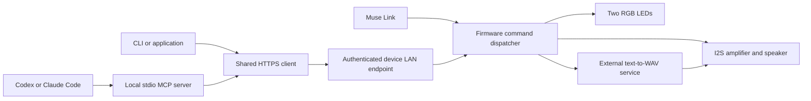

# From a bare board to Herald

Herald started with a practical question: could a spare ESP32 board give Muse
a voice on the desk? The board had two USB-C connectors and rows of GPIO pins,
but no built-in speaker, microphone or display. An NS4168 I2S amplifier and a
passive speaker supplied the missing audio hardware. A test tone established
that the wiring and audio output worked before speech entered the picture.

The next step separated speech generation from playback. A service elsewhere
on the network turns text into PCM WAV audio; Herald downloads and plays it.
That keeps the device's job small and lets the builder choose a speech engine.
It also means a working speaker is not enough for text-to-speech: the configured
service must be reachable and implement the documented request format.

## Making activity visible

Two common-cathode RGB LEDs added a second way to communicate. Each contains
three color channels, each wired through its own resistor. Firmware mixes those
channels with PWM. The tested wiring is captured in the
[wiring guide](../esp32/devices/herald-wiring.md); the board profile preserves
those assignments rather than guessing from the shape of the board.

The original board helper was called `xiao-s3`. Inspection identified the actual
board as an HW678 ESP32-S3 N16R8, so the public profile is
`hw678-n16r8-herald`. The old name survives as a compatibility alias, not as a
claim that the wiring fits a Seeed XIAO.

Static colors became patterns, and patterns became a narrated showcase. The
demo prepares speech, provides a recording countdown, and combines narration,
light animation and a synthesized melody. It is an example of what the outputs
can do together; everyday use can be as simple as a green light and “Tests passed.”

## Moving control out of the firmware build

Early experiments needed firmware changes to try a new effect. Remote commands
now expose colors, patterns, speech, playback, persistent defaults, diagnostics
and device management. New combinations of existing commands can run without
reflashing. New drivers or capabilities still require a firmware update; OTA
provides that route, with USB retained for recovery.

Muse discovers commands through Link registration. Long operations run as jobs,
so preparing speech or animating LEDs does not block the command dispatcher.
A returned job ID means the request was accepted, not that the speaker has
finished. Callers must inspect completion and errors.

## Opening the same device to other agents

The MCP implementation adds another entry point rather than another LED or
speaker implementation. A local stdio MCP server translates typed tool calls
into authenticated HTTPS requests. A shared TypeScript client supports that
server and the CLI. An optional HTTPS MCP service supports remote clients;
it is not installed automatically as a background service.

The device LAN endpoint uses a per-device TLS certificate and a separate random
bearer token. LAN clients coordinate using a temporary ownership lease and
bounded job records. Request IDs prevent duplicate execution within the
retention window. These controls do not arbitrate Muse's actions: Muse can
still replace an LED pattern or contend for the speaker. They also do not make
clients sharing a token separate security principals.

Administrative LAN operations are disabled by default. This remains a prototype
using the upstream public development signing key, without secure boot or flash
encryption. Private overlays, personalized binaries and flash backups stay out
of the public repository. The [audit report](../HERALD_RELEASE.md) records what
was checked, including the limits of those checks.

## What has been demonstrated

The prototype has played speech, animated both LEDs, retained settings and
accepted commands from Muse. The MCP hardware test exercised speech, job
completion, ownership conflicts, duplicate detection and cancellation. Its
speech was heard; its LED pattern reported completion but was not visually
observed during that particular test. Earlier LED tests were visually confirmed.
Host and transport tests provide additional evidence, not a substitute for
checking another builder's wiring and power supply.

To reproduce it, follow [Build Herald](../esp32/devices/herald.md), then the
[MCP and CLI guide](../herald-mcp/README.md). Supply your own Muse credentials
and speech service. No hosted service, preconfigured credentials or personalized
firmware image is included in this fork.
